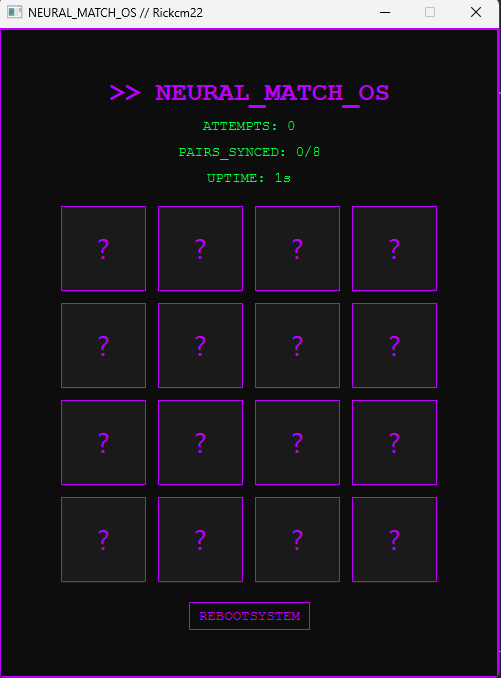

# 🧠 NEURAL_MATCH_OS // SYSTEM_OVERRIDE
> **Status:** Operational  
> **Environment:** Java 17+ / JavaFX / CSS (Cyberpunk UI)  
> **Origin:** Software Engineering Project

<p align="center">
  
</p>

---

## ⚡ Overview
**Neural Match OS** es un sistema de entrenamiento cognitivo y memoria visual desarrollado en Java utilizando la biblioteca **JavaFX**. El proyecto simula una interfaz de terminal avanzada bajo una estética *cyberpunk*, desafiando la retención de memoria visual del usuario mediante una dinámica fluida y un diseño de interfaz altamente personalizado.

Este software fue desarrollado como parte de mi formación en **Ingeniería de Software**, aplicando principios de Programación Orientada a Objetos (POO) y diseño avanzado de interfaces de usuario (UI).

## 🛠️ Technical Specs
- **Lenguaje:** Java 17+
- **Framework GUI:** JavaFX
- **Estilos:** CSS (JavaFX CSS - Estética DedSec)
- **Arquitectura:** Estructura modular y gestión de estados asíncronos (`PauseTransition`).

## ✨ Core Features
- **Interfaz Dinámica:** Transiciones fluidas y *feedback* visual inmediato en aciertos y fallos.
- **Temporizador de Uptime:** Control de tiempo transcurrido en tiempo real mediante hilos de sistema.
- **Feedback Estético:** Cambios de color reactivos al sincronizar pares en la cuadrícula.

## 📦 Installation & Execution
1. **Clona el repositorio:**
   ```bash
   git clone [https://github.com/Rickcm22/neural-match-os.git](https://github.com/Rickcm22/neural-match-os.git)
